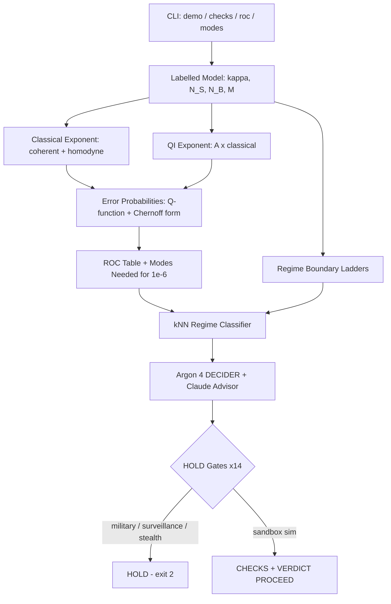
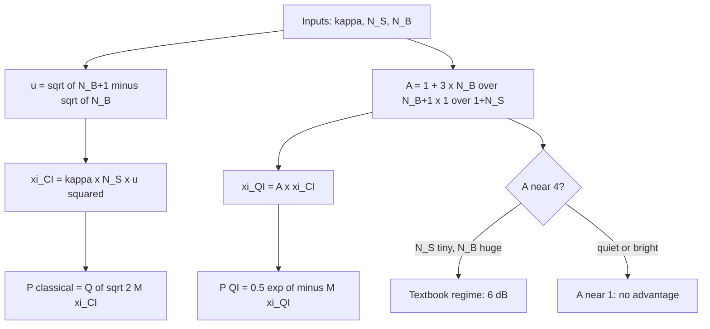
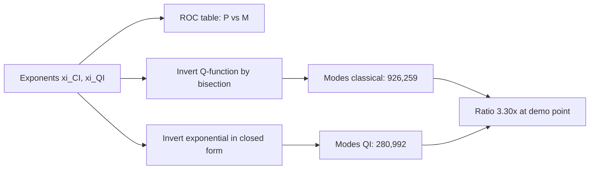
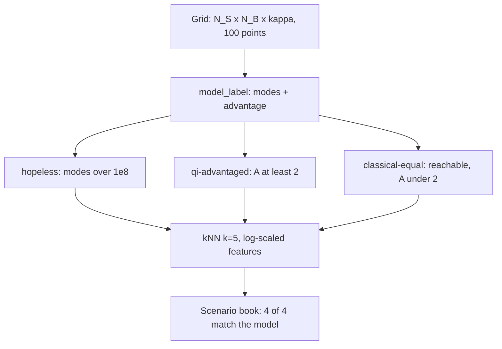
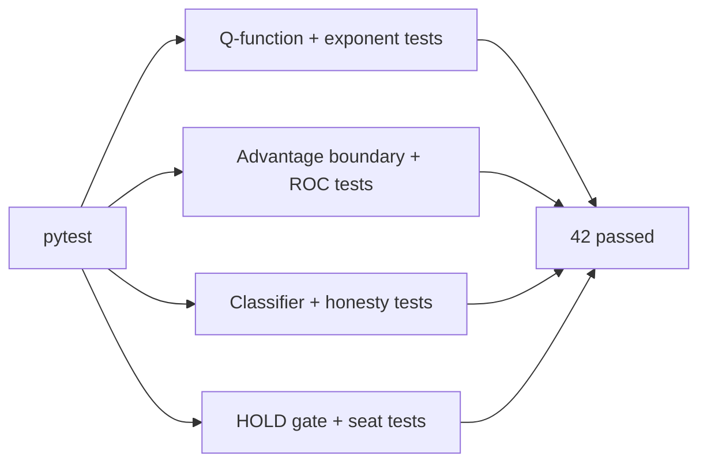
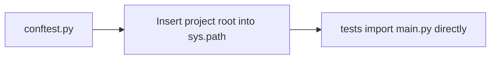
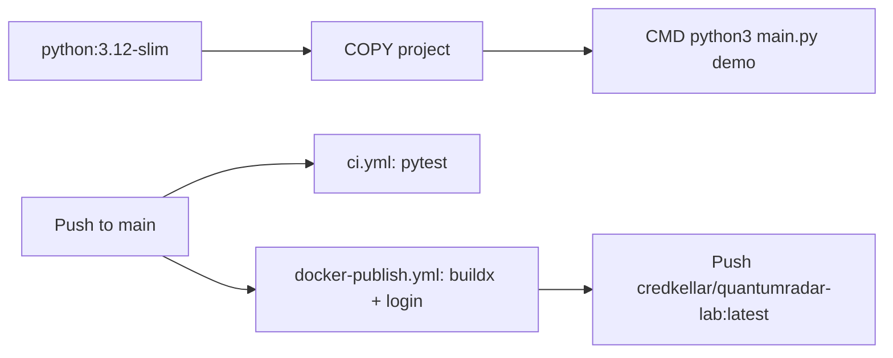

# QuantumRadar-Lab 📡⚛️

**Quantum Illumination / Quantum Radar Lab** — by Darion Kellar

QuantumRadar-Lab is an **educational quantum illumination lab** in ONE pure-Python file. It takes the most quoted result in quantum sensing — the **6 dB error-exponent advantage** of quantum illumination (Lloyd 2008; Tan et al. 2008) — and does the arithmetic in the open: binary hypothesis testing ("target present or absent?"), a classical coherent-state benchmark priced with a Gaussian Q-function, the entangled-source exponent next to it, and the **regime boundary where the advantage dies**, computed rather than quoted.

The honest scope is the whole point, and it is stated everywhere:

- ✅ **What it computes:** error exponents and error probabilities of a **labelled textbook Gaussian model** — every formula is printed in the code and in this README, and every parameter (reflectivity κ, signal brightness N_S, background brightness N_B, mode count M) is a labelled teaching value.
- 🚫 **What it can never do:** detect anything. **No radar was built, no photon was sent, no target was detected.** The model outputs exponents — never a range, a resolution, or a detection — and the returned signal is **not entangled** with the retained idler after the lossy noisy channel; the advantage survives in quantum-born correlations and needs a joint measurement. Any account that skips those two sentences is marketing, and this lab refuses to be quoted that way.

Every military / targeting / surveillance / stealth / weapons / air-defense / product use sits behind a permanent HOLD gate (14 total). 🔒

[](https://github.com/kimanicollier44-cmyk/QuantumRadar-Lab/actions/workflows/ci.yml)
[](https://github.com/kimanicollier44-cmyk/QuantumRadar-Lab/actions/workflows/docker-publish.yml)

> ℹ️ These are the **live** workflow badges for this repo. They activate as soon as the `ci.yml` and `docker-publish.yml` files from the paste pack are pasted into `.github/workflows/` — until then they have nothing to report yet.

## 🧰 Tech Stack Badges & Full Architecture Tech Stack

### 💻 Core Programming Languages & Core Systems


- 🐍 Python 3.12, pure standard library (`math`, `hashlib`, `json`, `sys`) — zero dependencies, zero network, deterministic (double-run byte-identical)
- 📐 The whole physics core is four labelled formulas: the classical Chernoff exponent `ξ_CI = κ·N_S·(√(N_B+1) − √N_B)²`, the Gaussian Q-function error probability `Q(√(2·M·ξ_CI))` via `math.erfc`, the QI exponent `ξ_QI = A·ξ_CI`, and the Chernoff-form `P_QI(M) = ½·exp(−M·ξ_QI)` — each asserted against its analytic limits in CHECKS
- 🎚️ The advantage factor `A = 1 + 3·[N_B/(N_B+1)]·[1/(1+N_S)]` is a **labelled interpolation**: its endpoints are the literature (A → 4 = 6 dB for N_S ≪ 1 ≪ N_B; A → 1 when N_B → 0 or N_S ≫ 1), and the lab computes the boundary between them instead of quoting the headline
- 🧠 TinyML kNN regime classifier (from scratch, stdlib): qi-advantaged / classical-equal / hopeless from (N_S, N_B, κ), labels generated by the regime model itself over a 100-point grid
- 🪑 Council seats: Gemini Argon 4 DECIDER (names-only, tighten-only) + Muse advisor (never overrides HOLD) + Google Flow plan-only (rendered = False, live = 0)

### ⛓️ Web3 & Infrastructure

- 🚫 **Not applicable — honestly.** No blockchain, no Web3, no tokens: the "infrastructure" here is a labelled formula model inside one offline file. No fake badges here.

### ⚙️ Platform Support & Hardware Architecture


- 🖥️ Pure Python — runs anywhere Python 3.12+ runs (Linux, macOS, Windows), plus the `python:3.12-slim` Docker image
- 🔒 No hardware is controlled, ever: real transmitters, receivers, antennas, and sources are permanent HOLD gates (see the gate table below)

### ⚡ Low-Level Infrastructure & Performance

- 🚫 **No low-level code — honestly.** No C, no C++, no GPU, no compiled extensions: this is one interpreted Python file on purpose, so every exponent can be read, checked, and diffed. Performance here means honest algorithms — a bisection inverse-Q solver, closed-form mode counts, and a 100-point kNN grid — all deterministic and byte-identical between runs.

### 🛠️ DevOps & Build Tools


- 🐳 Docker (`python:3.12-slim`), GitHub Actions CI + Docker Publish (delivered in the paste pack)
- 🎯 Target image: `credkellar/quantumradar-lab:latest`
- 🧪 Tests: `pytest` (42 tests) + the built-in CHECKS suite (52 checks) in `main.py`

### ☁️ Cloud Providers

- 🚫 **None — honestly.** No cloud provider is used or needed: the lab runs fully offline on your own machine or in a local Docker container. Docker Hub appears only as the registry the publish workflow pushes the image to.

## What this does?

1. 🎯 **Binary hypothesis testing** — the whole lab asks one question: *target present or absent?* If present, it reflects a labelled fraction **κ** of the signal. There is no image, no track, no range — a yes/no question with an error probability, which is exactly the question the Lloyd / Tan et al. literature answers.
2. 📉 **The classical benchmark, priced** — a coherent-state transmitter with a homodyne receiver: per-mode Chernoff exponent `ξ_CI = κ·N_S·(√(N_B+1) − √N_B)²`, error probability `P_CI(M) = Q(√(2·M·ξ_CI))` from the Gaussian Q-function. At the demo point (κ = 0.1, N_S = 0.01, N_B = 20): ξ_CI = **1.219694e-05** per mode.
3. ⚛️ **The quantum illumination exponent** — an entangled signal/idler source with an optimal joint receiver: `ξ_QI = A·ξ_CI` with the labelled advantage factor A. At the demo point A = **3.8289** (5.83 dB in exponent), ξ_QI = **4.670029e-05** — near, but visibly not at, the asymptotic 4×.
4. 🧭 **The regime boundary, computed** — A is swept along two ladders: against background brightness it climbs **1.03 → 1.27 → 2.49 → 3.70 → 3.94 → 3.97** (N_B = 0.01 → 1000); against signal brightness it falls **3.85 → 1.26** (N_S = 0.001 → 10). The 6 dB lives in a corner of parameter space, and the lab draws the corner.
5. 📊 **ROC-style table** — P_error vs mode count M for both transmitters at the demo point: at M = 10⁶ the classical benchmark sits at **3.93e-07** while QI is at **2.61e-21** — and at M = 10³ the lab honestly shows the Chernoff form sitting *above* the exact Gaussian number, because an exponent advantage is an asymptotic statement.
6. 🔢 **Modes needed for P_error = 1e-6** — inverting both error formulas: the classical benchmark needs **926,259 modes**, QI needs **280,992** — **3.30× fewer** at the demo point (the mode ratio is not the exponent ratio; the Q-function's prefactor takes its cut, and the lab says so).
7. 🎛️ **The receiver ladder** — homodyne on the return alone *is* the classical benchmark; a phase-conjugation / OPA receiver captures half the exponent gain (3 dB of 6 dB, labelled) at ξ_PC = **2.944861e-05**; the full Chernoff exponent needs an optimal joint measurement for which **no practical receiver is known** (labelled).
8. 📚 **A scenario book** — four operating points map the model: the textbook regime (qi-advantaged), a quiet background and a bright signal (both classical-equal — the advantage is gone), and faint-everything (hopeless: even the classical benchmark needs > 10⁸ modes).
9. 💔 **Entanglement honesty, as data** — `channel_honesty()` records it structurally: `return_state_entangled_with_idler = False`. The lossy noisy channel is entanglement-breaking; what survives is quantum-born correlation in a separable joint state, which is why the receiver must measure return and idler **jointly** — plus the labelled microwave-vs-optical practicality note (N_B ≫ 1 is natural at microwave frequencies, nearly absent at optical ones).
10. 🏷️ **Regime classifier + seats + checks** — a from-scratch kNN labels operating points qi-advantaged / classical-equal / hopeless with labels generated by the regime model itself, watched over by the Argon 4 DECIDER (sha256 trace), Muse advisor, Google Flow plan-only, and a built-in CHECKS suite (52 checks).

## 🗺️ How it works — diagram per script

### `main.py` — the whole lab



### `main.py` § the labelled model — two exponents, one boundary



### `main.py` § ROC + modes — from exponents to counts



### `main.py` § regime classifier — labels from the model



### `tests/test_main.py` — verification



### `conftest.py` — test path setup



### `Dockerfile` + CI flow — container & publish



## Why is this cool?

1. 📉 The 6 dB is **derived, not quoted**: the classical exponent, the QI exponent, and their ratio all come out of four printed formulas you can recompute on a napkin.
2. 🧭 The advantage has a **map**: two computed ladders show exactly where A climbs toward 4 and where it collapses to 1 — the regime boundary is the deliverable, not the headline.
3. 🔢 Exponents become **mode counts**: 926,259 vs 280,992 modes for the same 1e-6 error — and the lab admits the 3.30× mode ratio is *not* the 3.83× exponent ratio, and why.
4. 💔 The lab's proudest line is a **confession**: `return_state_entangled_with_idler = False`. The entanglement is broken by the channel; the advantage lives in correlations — stated in the data model, not a footnote.
5. 🎛️ The receiver ladder is **honest about the catch**: the full exponent needs a joint measurement nobody knows how to build; the buildable receiver gets half the gain. Both numbers are printed.
6. 📊 The ROC table shows the **unflattering rows too**: at M = 10³ the Chernoff form sits above the exact Gaussian number. An asymptotic advantage that hides its small-M behaviour would be a sales pitch; this is a lab.
7. 🌡️ The microwave/optical note teaches the **real engineering fork**: N_B ≫ 1 is free at microwave frequencies and nearly impossible at optical ones — the regime is a place, not a promise.
8. 🏷️ The classifier's labels come from the **model itself** — the kNN interpolates computed exponents and mode counts instead of inventing a second, hidden standard.
9. 🚫 The refusal list is **specific**: stealth-detection claims, drone-detection claims, and advantage-marketing claims are each their own permanent HOLD gate, not one vague "no misuse" line.
10. 🎯 Deterministic end to end: run it twice, get byte-identical output — a quantum radar *paper* you can diff.

## What problems this solves?

1. ❌ **Problem:** "Quantum radar defeats stealth" headlines with no model attached. ✅ **Solution:** The lab contains no range, no cross-section, and no detection — and `stealth_detection_claim` is a permanent HOLD gate. What exists is an error exponent for a yes/no question.
2. ❌ **Problem:** The 6 dB advantage quoted as a universal constant. ✅ **Solution:** A is computed across the (N_S, N_B) plane: 3.97 deep in the regime, 1.03 in a quiet background, 1.26 for a bright signal. The boundary is the lesson.
3. ❌ **Problem:** "Entanglement survives the trip and detects the target." ✅ **Solution:** The channel is entanglement-breaking and the code says so in a data field — the surviving advantage is in joint measurement of a separable, quantum-born-correlated state.
4. ❌ **Problem:** Exponent advantages that never become engineering numbers. ✅ **Solution:** Both error formulas are inverted into mode counts for a stated target error (1e-6), with minimality asserted in CHECKS.
5. ❌ **Problem:** Benchmarks that pick the weakest classical rival. ✅ **Solution:** The classical side is the literature's own benchmark — coherent state + homodyne, with its Chernoff exponent in the standard `(√(N_B+1) − √N_B)²` form and its high-noise limit κ·N_S/(4·N_B) asserted.
6. ❌ **Problem:** Receiver reality left out of the advantage story. ✅ **Solution:** A three-rung ladder — homodyne (classical), phase-conjugation (half the gain, labelled), optimal joint (full exponent, no known practical receiver, labelled).
7. ❌ **Problem:** Cherry-picked operating points. ✅ **Solution:** The scenario book deliberately includes the points where QI loses its edge and the point where *everything* is hopeless — all four are first-class outputs.
8. ❌ **Problem:** Asymptotic formulas sold as small-sample truth. ✅ **Solution:** The ROC table prints the small-M rows where the Chernoff form is loose, with the crossover explained in the demo text.
9. ❌ **Problem:** Sensing papers that need a cluster, a licence, and a physics degree to sanity-check. ✅ **Solution:** One offline Python file; the Q-function is `math.erfc`, the inverse is bisection, and every check runs in milliseconds.
10. ❌ **Problem:** Simulation tools that quietly imply a capability is next. ✅ **Solution:** 14 named HOLD gates return exit code 2 for every military, surveillance, construction, and product claim, forever.

## How to install this?

1. 📋 Clone or download this project folder:

```bash
git clone https://github.com/kimanicollier44-cmyk/QuantumRadar-Lab.git
```

2. 🐍 Make sure Python 3.12+ is installed: `python3 --version`
3. ▶️ Run the full demo + checks (no arguments needed):

```bash
python3 main.py
```

4. 🧪 Run the test suite:

```bash
pip install pytest
python3 -m pytest -q
```

5. 🎛️ Try the other commands:

```bash
python3 main.py checks   # 52 built-in checks
python3 main.py roc      # ROC table at the demo operating point (JSON)
python3 main.py modes    # exponent book + modes needed for 1e-6 (JSON)
python3 main.py regimes  # scenario book + regime boundary ladders (JSON)
python3 main.py honesty  # channel honesty: entanglement, receivers, bands
python3 main.py classify # kNN regime classifier report
python3 main.py brains   # Argon 4 + Muse + Flow seats
python3 main.py holds    # list all 14 HOLD gates
python3 main.py hold-demo # exits 2 - gated actions stay HOLD
```

6. 🐳 Or run it in Docker:

```bash
docker pull credkellar/quantumradar-lab:latest
docker run --rm credkellar/quantumradar-lab:latest
```

## Requirements

- 🐍 Python 3.12 or newer
- 📦 Dependencies: **none** (standard library only)
- 🌐 Network: **none** — fully offline
- 🧪 For tests only: `pytest`
- 🐳 Optional: Docker

## FULL project structure tree

```text
quantumradar-lab/
├── main.py                  # the whole lab: labelled QI model, exponents, ROC, mode counts, regime classifier, honesty, seats, HOLD gates
├── conftest.py              # puts the project root on sys.path for tests
├── tests/
│   └── test_main.py         # 42 pytest tests: Q-function, exponents, advantage boundary, modes, classifier, honesty, gates, seats
├── assets/
│   └── cover.png            # README cover image (2736 x 912)
├── .github/
│   └── workflows/
│       ├── ci.yml           # paste-in from the workflow pack
│       └── docker-publish.yml # paste-in from the workflow pack (tag: credkellar/quantumradar-lab:latest)
├── Dockerfile               # python:3.12-slim, runs the demo
├── .gitignore               # __pycache__/, .pytest_cache/, *.pyc
└── README.md                # this file
```

> 📦 Delivered separately as paste packs (not in this tree): `.github/workflows/ci.yml` + `docker-publish.yml`, and the Docker Hub pack (100-char description, 350-char About, overview, categories).

## 🔒 HOLD gates — all 14, permanent

| # | Gate | What stays held |
|---|------|-----------------|
| 1 | `military_targeting_use` | No targeting, fire-control, or weapons-aiming use of any kind |
| 2 | `surveillance_use` | No surveillance of people, vehicles, property, or airspace |
| 3 | `stealth_detection_claim` | No claim this model detects stealth aircraft or defeats low-observable design; the model produces no such result |
| 4 | `weapons_guidance_use` | No guidance, navigation-for-weapons, or terminal-homing use |
| 5 | `air_defense_application` | No air-defense, missile-warning, or interception application |
| 6 | `drone_detection_claim` | No drone / UAS detection claim; nothing here detects anything |
| 7 | `real_radar_construction` | No building a real radar, transmitter, or receiver from this lab |
| 8 | `live_target_detection` | No live detection of real objects; this lab runs no hardware and senses nothing |
| 9 | `range_or_performance_claim` | No range, resolution, sensitivity, or performance claim for any real system; the model outputs exponents, not ranges |
| 10 | `hardware_control` | No control of real transmitters, receivers, antennas, or sources |
| 11 | `product_or_deployment_claim` | No product, deployment, procurement, or capability claim; formula arithmetic is not a system |
| 12 | `advantage_marketing_claim` | The 6 dB figure is a labelled model exponent ratio inside a stated regime; never a product advantage or field capability |
| 13 | `medical_safety_imaging_claim` | No medical, safety-of-life, or imaging claim |
| 14 | `classified_or_export_design` | No classified, export-controlled, or restricted design work |

🧑‍⚖️ **Council seats:** Gemini Argon 4 Extended Thinking — DECIDER (names-only, tighten-only, MAP → MODEL → STRESS → DECIDE, sha256 trace, `can_override_hold = False`) · Muse — advisor (`can_override_hold = False`) · Google Flow — plan-only (`rendered = False`, `live = 0`).

✅ **Verification:** pytest **42 passed** (project + clean copy) · built-in CHECKS **52/52** · double-run output **byte-identical** · `hold-demo` exits **2** · `main.py` **777 lines**, pure stdlib, zero network.

## 🧒 5th-grade English section

Imagine you and a friend each hold one of a pair of **magic coins**. Whenever yours lands heads, your friend's lands tails — they always match in opposite ways, even far apart. 🪙

- **This lab is about a guessing game.** A toy target may or may not be hiding in a very noisy room — like trying to hear a whisper at a loud concert. You get to shout-whisper a question many, many times (the lab calls the tries *modes*) and count how often you guess right.
- **The ordinary way** is like sending a plain flashlight beam and listening for the echo. The **quantum way** sends one magic coin out and *keeps its twin*. The echo comes back mixed with so much noise that the magic is actually **broken** — the lab says this out loud! — but the twins still match in a faint pattern that plain coins never make, if you check the echo and the kept twin *together*.
- In the perfect corner of the game — whisper *very* quiet, room *very* loud — checking the twins together makes your mistakes shrink **four times faster** as you add tries. Step out of that corner (quiet room, or a loud flashlight) and the magic advantage **shrinks to nothing**. The lab draws the map of that corner with real numbers.
- Here is the most important part: **this is a math game on a computer.** Nobody built a real radar, nobody detected a real anything, and the lab will never tell you how far it can "see" — it can't see at all. It teaches why a whisper plus a twin coin can beat a flashlight *on paper*, and exactly when it can't. 💻

---

MIT © 2026 Darion Kellar · QuantumRadar-Lab — educational simulation only 📡
